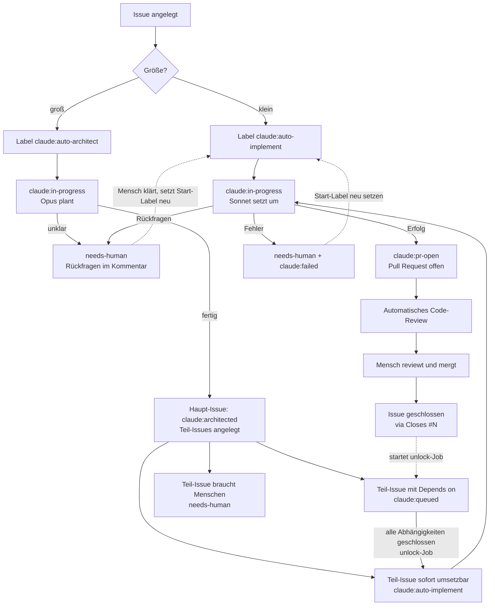

# Claude-Workflow in lifehub

Stand: 2026-10-18 (Commit 811aef7)

## Überblick

In diesem Repo arbeitet Claude über GitHub Actions mit. Gesteuert wird alles über **Labels** an Issues:

- **Kleine, klare Aufgabe** → Label `claude:auto-implement` → Claude (Modell *Sonnet*) programmiert die Lösung und öffnet einen Pull Request.
- **Große Aufgabe** → Label `claude:auto-architect` → Claude (Modell *Opus*) plant, zerlegt die Aufgabe in kleine Issues und startet deren Umsetzung in der richtigen Reihenfolge.
- Jeder Pull Request bekommt automatisch ein **Code-Review** von Claude.
- **Gemergt wird immer von einem Menschen.**

## Die Workflow-Dateien

### `claude-implement.yml` – „Claude – Implement (Sonnet)“
**Startet, wenn:** an einem Issue das Label `claude:auto-implement` gesetzt wird – oder wenn der Architect-Workflow ihn per `workflow_dispatch` mit einer Issue-Nummer aufruft.

**Was passiert:**
1. Label `claude:in-progress` wird gesetzt, alte Status-Labels (`claude:failed`, `needs-human`, `claude:queued`) werden entfernt.
2. Claude liest das Issue (und das übergeordnete Issue aus „Teil von #N“) sowie `CLAUDE.md`.
3. Ist etwas unklar oder riskant (z. B. Secrets, Security, Änderungen an `.github/workflows/`), stellt Claude nummerierte Rückfragen als Kommentar und hört auf.
4. Sonst: Branch `claude/issue-<Nummer>` anlegen, umsetzen, Prüfungen aus `CLAUDE.md` laufen lassen, committen, pushen, Pull Request mit „Closes #<Nummer>“ öffnen.
5. Am Ende wird das Ergebnis als Label gemeldet: `claude:pr-open` (PR offen), `needs-human` (Rückfragen) oder `needs-human` + `claude:failed` (Fehlschlag, mit Kommentar und Link zum Lauf).

Claude mergt nie und ändert selbst keine Labels – das macht der Workflow.

### `claude-architect.yml` – „Claude – Architect (Opus)“
Diese Datei hat **zwei Jobs**.

**Job `architect`** – startet, wenn an einem Issue das Label `claude:auto-architect` gesetzt wird.
1. Label `claude:in-progress` wird gesetzt.
2. Claude liest das Issue und den Code, schreibt **keinen Code**.
3. Ist die Aufgabe zu unklar: Rückfragen als Kommentar → Label `needs-human`.
4. Sonst legt Claude kleine Teil-Issues an (je Issue genau ein PR). Jedes enthält „Teil von #N“, Ziel, Dateien, Schnittstellen, Schritte, Akzeptanzkriterien, Tests und ggf. Zeilen `Depends on #<Nummer>`.
5. Claude postet im Haupt-Issue einen Kommentar „🏗️ Architektur“ mit der Übersicht.
6. Der Workflow verteilt dann Labels an die neuen Issues:
   - sofort umsetzbar → `claude:auto-implement` und Start von `claude-implement.yml`
   - wartet auf andere Issues → `claude:queued`
   - braucht einen Menschen → `needs-human`

   Das Haupt-Issue bekommt `claude:architected`.

**Job `unlock`** – startet, wenn **irgendein** Issue geschlossen wird (oder manuell).
Er geht alle offenen Issues mit `claude:queued` durch. Sind alle `Depends on #…`-Issues geschlossen, wird `claude:queued` durch `claude:auto-implement` ersetzt und `claude-implement.yml` gestartet.

### `claude-code-review.yml` – „Claude Code Review“
**Startet, wenn:** ein Pull Request geöffnet, aktualisiert, wieder geöffnet oder „ready for review“ wird.
Claude prüft den PR mit dem offiziellen Plugin `code-review` und schreibt Kommentare direkt in den PR. Hat nur Leserechte, ändert also nichts.

### `claude.yml` – „Claude Code“
**Startet, wenn:** jemand in einem Issue, Issue-Kommentar, PR-Review oder Review-Kommentar `@claude` schreibt.
Claude beantwortet dann die Anfrage. In dieser Konfiguration hat der Workflow nur **Leserechte** auf Code, PRs und Issues (plus Lesen von CI-Ergebnissen).

### `claude-labels.yml` – „Claude – Labels anlegen“
**Startet nur manuell** (Actions → Run workflow). Legt alle `claude:*`-Labels und `needs-human` mit Farbe und Beschreibung an bzw. aktualisiert sie. Mehrfaches Ausführen schadet nicht.

## Labels

| Label | Wer setzt es? | Bedeutung / Wirkung |
|---|---|---|
| `claude:auto-implement` | Mensch (oder Architect-Workflow) | Startet die Umsetzung durch Sonnet. Vom Workflow gesetzt nur zur Anzeige – gestartet wird dann per `workflow_dispatch`. |
| `claude:auto-architect` | Mensch | Startet die Planung durch Opus. |
| `claude:queued` | Architect-Workflow (oder Mensch) | Wartet auf andere Issues (`Depends on #…`). Wird vom `unlock`-Job freigegeben. |
| `claude:in-progress` | Workflow | Claude arbeitet gerade. |
| `claude:architected` | Architect-Workflow | Planung fertig, Teil-Issues angelegt. |
| `claude:pr-open` | Implement-Workflow | PR ist offen – bitte reviewen und mergen. |
| `claude:failed` | Workflow | Automatischer Lauf ist fehlgeschlagen (Details im Kommentar). |
| `needs-human` | Workflow | Ein Mensch muss etwas klären oder tun. |

Daneben gibt es im Repo die GitHub-Standardlabels (`bug`, `documentation`, `enhancement` …) und die Labels `needs-human:access`, `needs-human:decision`, `needs-human:manual-test`, `needs-human:risky`. Die `needs-human:*`-Labels werden von **keinem** Workflow gesetzt; sie sind nur für manuelle Nutzung da.

## Lifecycle eines Issues

## Typische Abläufe

**Kleine Aufgabe**
1. Issue schreiben, Label `claude:auto-implement` setzen.
2. Warten, bis `claude:pr-open` erscheint.
3. PR und Review-Kommentare ansehen, mergen → Issue wird geschlossen.

**Große Aufgabe (Epic)**
1. Issue mit der Gesamtaufgabe schreiben, Label `claude:auto-architect` setzen.
2. Opus legt Teil-Issues an und startet die ersten.
3. Jeden PR reviewen und mergen. Nach jedem geschlossenen Issue startet der `unlock`-Job automatisch die nächsten wartenden Teil-Issues.

**Wenn etwas hängt**
- `needs-human`: Fragen im Issue beantworten, dann das Start-Label (`claude:auto-implement` bzw. `claude:auto-architect`) **entfernen und neu setzen**.
- `claude:failed`: Link zum Lauf im Kommentar öffnen, Ursache beheben, Start-Label neu setzen.
- Wartende Issues manuell prüfen: Actions → „Claude – Architect (Opus)“ → Run workflow.

## Bekannte Besonderheiten (Stand 2026-10-18)

- **Warum `workflow_dispatch`?** Aktionen mit dem `GITHUB_TOKEN` (z. B. ein vom Workflow gesetztes Label) starten laut GitHub-Doku keine neuen Workflow-Läufe; `workflow_dispatch` ist die Ausnahme. Deshalb startet der Architect-Workflow Umsetzungen per `gh workflow run`. Quelle: https://docs.github.com/en/actions/concepts/security/github_token
- **`claude:queued` startet immer Implement**, nie Architect. Verbesserung ist in #13 geplant.
- **Label `claude:architected` fehlt aktuell im Repo**, obwohl der Architect-Workflow es setzt. Außerdem weichen Farbe/Beschreibung von `claude:auto-implement`, `claude:auto-architect` und `claude:failed` von `claude-labels.yml` ab. Abhilfe: Workflow „Claude – Labels anlegen“ einmal starten.
- **`@claude` (claude.yml) hat nur Leserechte** – es kann antworten, aber keinen Code pushen.
- Bei Workflow-Dateien (`.github/workflows/`) fragt Implement immer einen Menschen; solche Änderungen also selbst oder interaktiv umsetzen.
